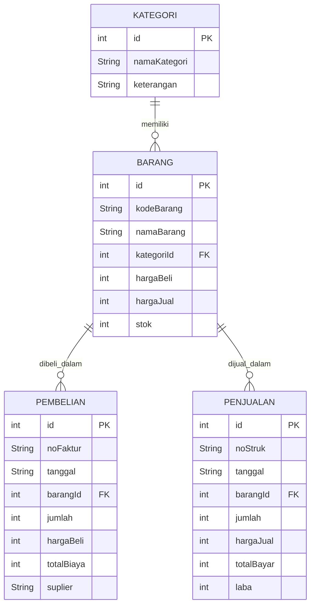

# UJIAN TENGAH SEMESTER (UTS)
## PROGRAM STUDI TEKNIK INFORMATIKA / SISTEM INFORMASI
### TAHUN AKADEMIK 2026/2027

| Mata Kuliah | Mobile Multimedia Solution (Pemrograman Dart) |
| :--- | :--- |
| **Sifat Ujian** | Praktik / Proyek Mandiri |
| **Media Eksekusi** | Dart Native Console (CLI) & Penyimpanan Data Persisten |
| **Batas Waktu** | Sesuai Jadwal Kalender Akademik UTS |

---

## A. DESKRIPSI SOAL & STUDI KASUS

Setiap mahasiswa diwajibkan untuk membangun sebuah **Sistem Informasi Manajemen Pencatatan Pembelian dan Penjualan Toko Kelontong Sederhana** berbasis **Dart Native** yang dijalankan secara interaktif melalui **Terminal / Command Line Interface (CLI)** dengan penyimpanan data persisten (*File-based JSON / SQLite*).

Aplikasi ini bertujuan untuk menguji pemahaman mahasiswa terkait:
1. Pemrograman Berorientasi Objek (**OOP**) pada bahasa Dart (Class, Object, Constructor, Encapsulation).
2. Mekanisme **Serialisasi & Deserialisasi Data** (`toMap` dan `fromMap`).
3. Pengelolaan data relasional antar entitas (**One-to-Many Relationship**).
4. Logika bisnis transaksi:
   - **Transaksi Pembelian (Kulakan):** Menambah stok fisik barang dan memperbarui harga modal beli secara otomatis.
   - **Transaksi Penjualan (Kasir):** Melakukan validasi ketersediaan stok, memotong stok fisik secara otomatis, dan menghitung keuntungan/laba bersih per transaksi.
5. **Laporan Arus Keuangan:** Akumulasi modal kulakan, omzet penjualan, laba bersih, serta total valuasi aset barang di toko.

Seluruh file kode harus disusun secara **modular** (terpisah per fitur/fungsi) dan dilengkapi file batch launcher (`jalankan_aplikasi.bat`) agar dapat dieksekusi sekali klik pada lingkungan Windows.

---

## B. RANCANGAN STRUKTUR ENTITAS & DATA MODEL

Sistem mengelola **4 entitas data yang saling berelasi**:

### 1. Diagram Relasi Entitas (ERD)



---

### 2. Spesifikasi Atribut Kelas Model (Dart Class)

#### a. Kelas Model: `Category` (`kategori.dart`)
| Properti | Tipe Data | Deskripsi |
| :--- | :--- | :--- |
| `id` | `int` | Nomor identitas unik kategori |
| `namaKategori` | `String` | Nama kelompok barang (misal: Sembako, Minuman) |
| `keterangan` | `String` | Deskripsi singkat kelompok barang |

#### b. Kelas Model: `Product` (`barang.dart`)
| Properti | Tipe Data | Deskripsi |
| :--- | :--- | :--- |
| `id` | `int` | Identifier unik produk |
| `kodeBarang` | `String` | Kode unik barang, misal `BRG001` |
| `namaBarang` | `String` | Nama lengkap produk |
| `kategoriId` | `int` | Relasi ID ke kelas `Category` |
| `hargaBeli` | `int` | Harga modal beli terakhir toko per unit (Rp) |
| `hargaJual` | `int` | Harga jual eceran ke konsumen per unit (Rp) |
| `stok` | `int` | Jumlah fisik stok barang yang tersedia (unit) |

#### c. Kelas Model: `Purchase` (`pembelian.dart` - Kulakan / Restock)
| Properti | Tipe Data | Deskripsi |
| :--- | :--- | :--- |
| `id` | `int` | Identifier unik transaksi kulakan |
| `noFaktur` | `String` | Nomor bukti faktur kulakan (misal: `PB-202611-001`) |
| `tanggal` | `String` | Tanggal transaksi (format: `YYYY-MM-DD HH:MM`) |
| `barangId` | `int` | Relasi ID ke barang yang dibeli |
| `jumlah` | `int` | Jumlah unit yang dibeli dari supplier |
| `hargaBeli` | `int` | Harga beli per unit saat transaksi |
| `totalBiaya` | `int` | `jumlah * hargaBeli` |
| `suplier` | `String` | Nama toko grosir / distributor supplier |

#### d. Kelas Model: `Sale` (`penjualan.dart` - Kasir Konsumen)
| Properti | Tipe Data | Deskripsi |
| :--- | :--- | :--- |
| `id` | `int` | Identifier unik transaksi penjualan |
| `noStruk` | `String` | Nomor bukti struk belanja (misal: `PJ-202611-001`) |
| `tanggal` | `String` | Tanggal transaksi kasir |
| `barangId` | `int` | Relasi ID ke barang yang terjual |
| `jumlah` | `int` | Jumlah unit yang dibeli konsumen |
| `hargaJual` | `int` | Harga jual per unit saat transaksi |
| `totalBayar` | `int` | `jumlah * hargaJual` |
| `laba` | `int` | `(hargaJual - hargaBeliBarang) * jumlah` |

---

### 3. Data Dummy Awal (Initial Seeding)

Saat aplikasi pertama kali dijalankan dan file penyimpanan belum ada, sistem harus otomatis menginisialisasi data dummy berikut:

- **Data Kategori Awal:**
  1. `[ID: 1]` Sembako *(Kebutuhan pokok beras, minyak, gula)*
  2. `[ID: 2]` Minuman *(Kopi, teh, susu, dan air mineral)*
  3. `[ID: 3]` Makanan Ringan *(Biskuit, keripik, dan mie instan)*
  4. `[ID: 4]` Kebersihan *(Sabun mandi, pasta gigi, deterjen)*

- **Data Barang Awal:**
  1. `[BRG001]` Beras Ramos 5kg (Kat: Sembako, Beli: Rp 65.000, Jual: Rp 72.000, Stok: 15)
  2. `[BRG002]` Minyak Goreng Sawit 1L (Kat: Sembako, Beli: Rp 14.000, Jual: Rp 16.500, Stok: 20)
  3. `[BRG003]` Gula Pasir Kristal 1kg (Kat: Sembako, Beli: Rp 15.000, Jual: Rp 17.500, Stok: 25)
  4. `[BRG004]` Kopi Kapal Api 165g (Kat: Minuman, Beli: Rp 12.000, Jual: Rp 14.000, Stok: 30)
  5. `[BRG005]` Indomie Goreng Original (Kat: Makanan Ringan, Beli: Rp 2.800, Jual: Rp 3.500, Stok: 80)
  6. `[BRG006]` Sabun Mandi Lifebuoy (Kat: Kebersihan, Beli: Rp 3.500, Jual: Rp 4.500, Stok: 40)

---

## C. SPESIFIKASI ARSITEKTUR FILE & MODULARITAS KODE

Proyek harus diorganisasi secara modular dengan struktur direktori sebagai berikut:

```text
uts_dart_toko_kelontong/
│
├── pubspec.yaml               # Metadata & konfigurasi Dart SDK
├── database.json              # File penyimpanan persisten data toko (JSON)
├── koneksi.dart               # Service database (DAO), model entitas, & helper CLI
├── main.dart                  # Titik masuk utama & dashboard menu CLI
├── barang.dart                # Tampil tabel barang (relasi kategori) & submenu barang
├── add_barang.dart            # Modul tambah data master barang
├── edit_barang.dart           # Modul ubah data barang
├── delete_barang.dart         # Modul hapus barang (proteksi relasi transaksi)
├── transaksi_beli.dart        # Transaksi kulakan (otomatis tambah stok +)
├── riwayat_beli.dart          # Histori pembelian dari supplier & total modal
├── transaksi_jual.dart        # Kasir penjualan (validasi stok & potong stok -)
├── riwayat_jual.dart          # Histori penjualan ke konsumen & total laba
├── laporan_keuangan.dart      # Rekap omzet, total modal, laba bersih, valuasi aset
├── kategori.dart              # Kelola master kategori & hitung barang per kategori
├── jalankan_aplikasi.bat      # Script batch Windows sekali klik
└── README.md                  # Dokumentasi panduan penggunaan & identitas mahasiswa
```

---

## D. ATURAN BISNIS & LOGIKA PEMROGRAMAN DART

1. **Logika Transaksi Pembelian (`transaksi_beli.dart`):**
   - Pengguna memilih barang dari daftar, memasukkan jumlah beli dan harga beli satuan baru.
   - Program menghitung: $\text{totalBiaya} = \text{jumlah} \times \text{hargaBeli}$.
   - Sistem mencatat record baru pada riwayat pembelian.
   - Sistem **otomatis menambahkan stok barang**:
     $$\text{stokBaru} = \text{stokLama} + \text{jumlah}$$
     Serta memperbarui `hargaBeli` pada data barang.

2. **Logika Transaksi Penjualan (`transaksi_jual.dart`):**
   - Pengguna memilih barang dan memasukkan jumlah unit yang ingin dibeli konsumen.
   - **Validasi Stok (PENTING):** Program harus memeriksa apakah $\text{stok} \ge \text{jumlah}$. Jika jumlah beli melebihi stok yang ada, transaksi **ditolak** dengan pesan:
     `[ERROR] Stok barang tidak mencukupi! Stok tersedia saat ini: X unit.`
   - Jika stok mencukupi, program menghitung:
     $$\text{totalBayar} = \text{jumlah} \times \text{hargaJual}$$
     $$\text{laba} = (\text{hargaJual} - \text{hargaBeli}) \times \text{jumlah}$$
   - Sistem mencatat ke daftar penjualan dan **otomatis mengurangi stok fisik**:
     $$\text{stokBaru} = \text{stokLama} - \text{jumlah}$$

3. **Laporan Keuangan & Laba Rugi (`laporan_keuangan.dart`):**
   - Menghitung Total Pengeluaran Kulakan: $\sum \text{pembelian.totalBiaya}$
   - Menghitung Total Penerimaan Penjualan (Omzet): $\sum \text{penjualan.totalBayar}$
   - Menghitung Total Keuntungan Bersih: $\sum \text{penjualan.laba}$
   - Menghitung Total Valuasi Aset Stok Toko: $\sum (\text{barang.hargaBeli} \times \text{barang.stok})$

---

## E. MOCKUP INTERFACE TERMINAL (CLI)

```text
========================================================================================
            SISTEM KASIR & KULAKAN TOKO KELONTONG (DART NATIVE CLI)                     
========================================================================================
ID   | KODE     | NAMA BARANG                  | KATEGORI         | HARGA JUAL    | STOK  
----------------------------------------------------------------------------------------
1    | BRG001   | Beras Ramos 5kg              | Sembako          | Rp 72.000     | 15 unit
2    | BRG002   | Minyak Goreng Sawit 1L       | Sembako          | Rp 16.500     | 20 unit
3    | BRG003   | Gula Pasir Kristal 1kg       | Sembako          | Rp 17.500     | 25 unit
4    | BRG004   | Kopi Kapal Api 165g          | Minuman          | Rp 14.000     | 30 unit
5    | BRG005   | Indomie Goreng Original      | Makanan Ringan   | Rp  3.500     | 80 unit
6    | BRG006   | Sabun Mandi Lifebuoy         | Kebersihan       | Rp  4.500     | 40 unit
========================================================================================

PILIHAN MENU UTAMA:
 [1] Kasir Penjualan Barang (Kurangi Stok & Hitung Laba)
 [2] Pembelian / Kulakan Barang (Tambah Stok Otomatis)
 [3] Riwayat Transaksi Penjualan
 [4] Riwayat Transaksi Pembelian (Kulakan)
 [5] Laporan Ringkasan Keuangan Toko (Omzet & Laba)
 [6] Manajemen Master Barang (Tambah, Ubah, Hapus)
 [7] Manajemen Kategori Barang
 [0] Keluar Aplikasi
----------------------------------------------------------------------------------------
Pilih menu [0-7]: 
```

---

## F. PANDUAN PENGUJIAN / SKENARIO TEST (TEST CASES)

| No | Skenario Pengujian | Aksi Pengujian | Hasil yang Diharapkan |
| :---: | :--- | :--- | :--- |
| **TC-01** | **Tambah Barang Baru** | Tambahkan barang `Teh Pucuk 350ml`, kategori `Minuman`, beli `Rp 2.500`, jual `Rp 3.500`, stok `10`. | Data tersimpan persisten dan muncul pada daftar barang dengan nama kategori yang tepat. |
| **TC-02** | **Transaksi Kulakan (Pembelian)** | Beli barang `Beras Ramos 5kg` (stok awal 15) sebanyak `10 unit`. | 1. Tercatat pada riwayat pembelian.<br>2. Stok barang otomatis bertambah menjadi `25 unit`. |
| **TC-03** | **Transaksi Penjualan Normal** | Jual `Beras Ramos 5kg` sebanyak `3 unit` dengan harga `Rp 72.000`. | 1. Tercatat pada riwayat penjualan.<br>2. Total bayar: `Rp 216.000`.<br>3. Laba tercatat: `Rp 21.000`.<br>4. Stok otomatis terpotong menjadi `22 unit`. |
| **TC-04** | **Validasi Penjualan Melebihi Stok (*Negative Test*)** | Coba jual `Minyak Goreng Sawit 1L` sebanyak `999 unit` (stok hanya 20). | 1. Sistem **menolak transaksi** dengan pesan peringatan.<br>2. Stok barang tidak berkurang dan transaksi tidak disimpan. |
| **TC-05** | **Verifikasi Laporan Keuangan** | Buka menu [5] Laporan Keuangan. | Sistem menampilkan akumulasi total pembelian modal, total omzet penjualan, laba bersih, dan valuasi aset fisik toko secara presisi. |

---

## G. RUBRIK PENILAIAN (TOTAL: 100 POIN)

| No | Aspek Penilaian | Bobot | Kriteria Evaluasi |
| :---: | :--- | :---: | :--- |
| **1** | **Penerapan OOP & Struktur Data Dart** | **20%** | Desain class model lengkap (`Category`, `Product`, `Purchase`, `Sale`), enkapsulasi baik, serta metode serialisasi `toMap()` dan `fromMap()` berjalan tepat. |
| **2** | **Logika Transaksi Pembelian (Kulakan)** | **20%** | Input transaksi pembelian berhasil mencatat histori dan otomatis menambahkan stok fisik barang secara persisten. |
| **3** | **Logika Transaksi Penjualan (Kasir)** | **25%** | Penjualan memotong stok barang dengan benar, menolak input yang melebihi ketersediaan stok, dan menghitung laba transaksi secara presisi. |
| **4** | **Laporan Keuangan & Relasi Antar Entitas** | **15%** | Menampilkan laporan omzet, pengeluaran kulakan modal, estimasi laba bersih toko, serta menampilkan nama kategori pada tabel barang. |
| **5** | **Manajemen Master Data (CRUD Barang & Kategori)** | **10%** | Kemampuan menambah, menampilkan, mengedit, dan menghapus master data dengan validasi input. |
| **6** | **Kerapian Antarmuka CLI & File Launcher (`.bat`)** | **10%** | Tampilan tabel konsol rapi (`padRight()`), penanganan error tidak membuat program crash, dan file `.bat` dapat dijalankan sekali klik di Windows. |

---

## H. KETENTUAN PENGUMPULAN BERKAS

1. Folder proyek diberi nama sesuai format:
   `UTS_MMS_[NIM]_[NAMA MAHASISWA]`
   *Contoh:* `UTS_MMS_202611008_SITI_NURHALIZA`
2. Di dalam folder proyek harus mencakup seluruh berkas:
   - Berkas source code Dart lengkap (`.dart`).
   - Berkas konfigurasi `pubspec.yaml`.
   - Berkas basis data persisten `database.json` (sudah terisi data dummy awal).
   - Berkas launcher `jalankan_aplikasi.bat`.
   - Berkas `README.md` berisi identitas mahasiswa, penjelasan modul, dan panduan menjalankan.
3. Folder dikompresi ke dalam bentuk `.ZIP` dan diunggah ke portal e-learning kampus sebelum batas waktu berakhir.

